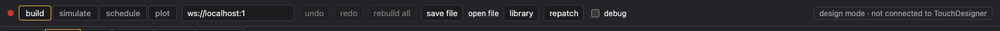

# Getting started

## Run the UI

```sh
cd web && npm install && npm run dev
```

Open http://localhost:5173. The show autosaves in the browser, so a reload keeps it.

## Connect TouchDesigner

Set up the bridge once in your `.toe` (see [TD bridge setup](../README.md#setup-in-td)): a Base COMP `bridge` holding a WebServer DAT on port 9980.

The address field in the header (`ws://localhost:9980`) points at it. The dot on the far left turns green when connected. Until then the header says **design mode · not connected to TouchDesigner** and you can still build everything; TouchDesigner gets the show when it connects. If both sides changed, you're asked whose show to keep.



| Button | Does |
| --- | --- |
| build / simulate / schedule / plot | The four pages: the editor, a 3D preview, the patch sheet and the printable plot. |
| undo / redo | ⌘Z / ⇧⌘Z, up to 100 steps. |
| rebuild all | Rebuilds every block in TouchDesigner. Use it if TD looks out of step with the UI. |
| save file / open file | Download the show as JSON, or load one (replaces the current show). |
| library | Import fixtures from the Open Fixture Library, and share fixture profiles, tube designs, palettes and composites. |
| repatch | Numbers DMX addresses along each cable chain from 1. |
| debug | Live values and sparklines next to the ports of the selected blocks (needs TD). |

## The build page

The tabs under the header are the editor:

- **layout**: the room, seen from above. Floors, rooms, fixtures, DMX nodes, controllers, audio gear, pixel controllers and LED tubes, and the cables between them. See [Layout](layout.md).
- **show**: the logic that decides which scene is on. Inputs from the layout on the left, scenes on the right. See [Show and scenes](show-and-scenes.md).
- **one tab per scene** (Fall, Winter… in the demo): what that scene does with its inputs and what it sends to the fixtures.

Composites you open get their own `› name` tab.


## Editing

- **Add**: drag a block from the palette on the left onto the canvas, or double-click it. The palette has tabs per editor tab, and the search box finds blocks from every tab.
- **Edit**: click a block; its settings open on the right.
- **Wire**: drag from an output port (right side) to an input port (left side). Ports are colour-coded by type and only matching types connect: signal green, index orange, number grey, audio red, colour pink, look purple, DMX blue, multichannel light blue.
- **Delete**: Backspace removes the selected blocks or wires.
- **Copy**: ⌘C / ⌘V copies the selected blocks with the wires between them.
- **Select many**: shift-drag a box, or ⌘-click. The panel then edits what they share.
- **Wire many**: ⌘- or shift-click ports to pick them, then drag one wire: picked sets pair up top to bottom, or one port fans out to all of them.
- **Focus**: selecting a block dims the wires that don't touch it. The eye on a scene node hides its wires until you select it.

Every block has a **Ports** list at the bottom of its panel. Untick inputs you don't use to keep the node short.
