# Layout

The layout tab is the venue from above, at real size: bright grid lines every metre, faint ones every 25 cm, and dragging snaps to 5 cm. It holds the hardware: fixtures, DMX nodes and controllers, audio gear, pixel controllers, LED tubes and rooms. The simulator, schedule and plot all read from it.

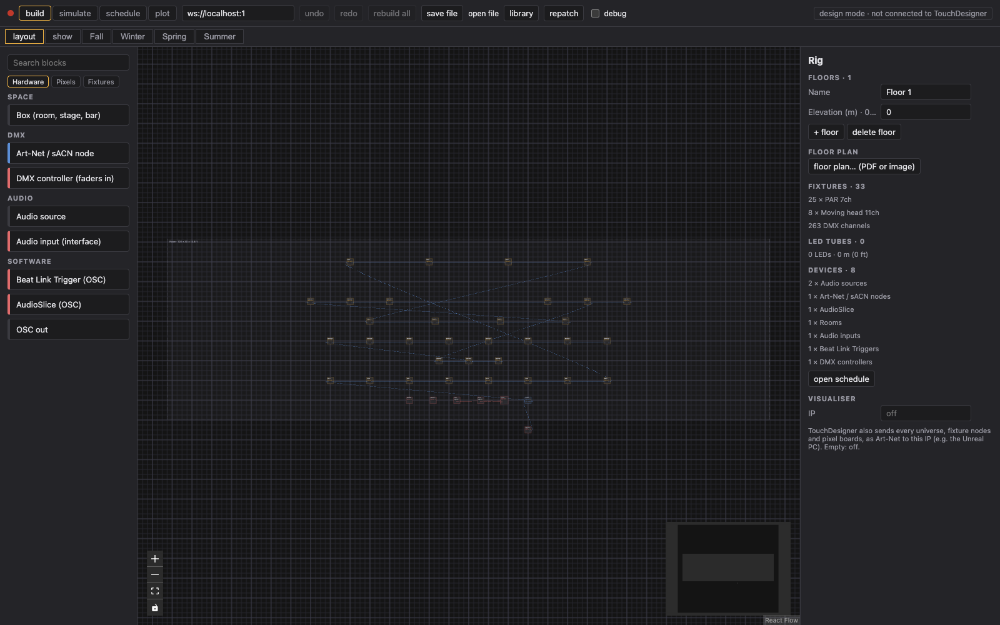

With nothing selected, the right panel is the **Rig**: floors, the floor plan, and a count of fixtures, DMX channels, LED tubes and devices.

## Placing things

Click anything to place it. Every device has:

- **Height, X, Z** in metres. Type `100ft` or `30'` for feet.
- **Turn, tilt, roll**, with ↺ / ↻ 90°, **flip H** (turn around) and **flip V** (hang upside down).
- **to ceiling** and **to wall** snap it to the room it stands in.
- **Flip ports** swaps the in and out sides, to tidy cables.

The simulator edits the same placement, so you can also drag fixtures in 3D.

## Floors and floor plans

The Rig panel starts with one floor. **+ floor** adds one above; give it a name and an elevation. With more than one floor, tabs at the top left of the canvas switch between them, and **all** shows every floor with the others greyed. Only an empty floor can be deleted.

To trace a venue:

1. **floor plan…** in the Rig panel and pick a PDF (you then pick the page) or an image.
2. Click two points a known distance apart, e.g. the ends of a dimension line, and type the real distance (`12.5 m` or `41 ft`).
3. Drag the plan to line it up, set the opacity, and tick **Plan locked** so clicks go through to the canvas.

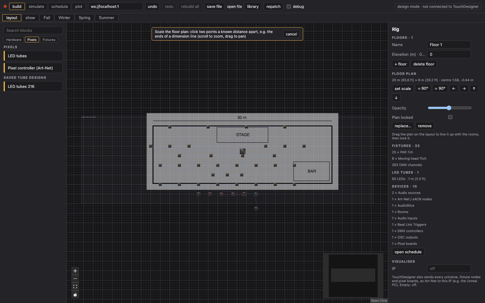

The plan also shows on the simulator floor and the lighting plot.

## Rooms

A **Box (room, stage, bar)** from the Hardware tab has a width, depth and height. Draw one per room, stage or bar; tick **Locked** once it's placed so dragging on it pans the view. Fixtures know which room they're in: the schedule lists it, and a scene can be limited to some rooms (see [Show and scenes](show-and-scenes.md#rooms)).

## Fixtures

The palette's **Fixtures** tab lists the fixture types in the show. Drag one in for each light.

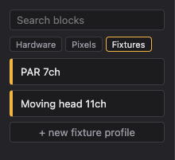

For more types:

- **library → Open Fixture Library → search**, type a maker or model and press **use**. The profile is copied into the show and appears in the Fixtures tab.
- **+ new fixture profile** builds one by hand: the channels in DMX order and what each one does.

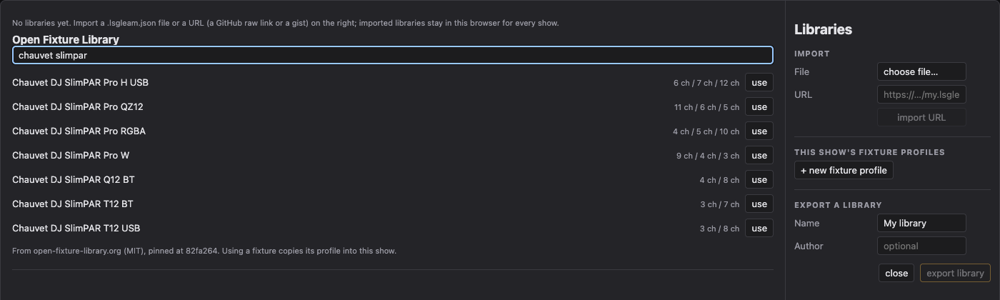

A fixture's panel has its **Mode** (the channel count), its **Address**, and sliders for its own values. Those values are what it shows when no scene is driving it.

A mode without a dimmer channel still gets an **Intensity** input: TouchDesigner multiplies every colour channel (red, green, blue, white, amber, UV) by it, so you dim it like any other fixture. Inputs for channels the current mode lacks stay wireable and do nothing until you switch to a mode that has them.

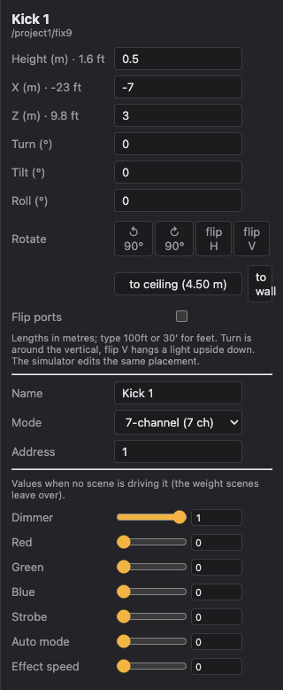

## DMX: nodes, chains and controllers

An **Art-Net / sACN node** is the interface TouchDesigner sends DMX through. Set its protocol, IP and universes; each universe is **out** (to lights) or **in** (from a desk or fader box).

Cable an out universe to the first fixture's DMX in, then that fixture's DMX out to the next, and so on. A fixture's universe is whatever its chain starts from. The node's panel lists each chain with addresses.

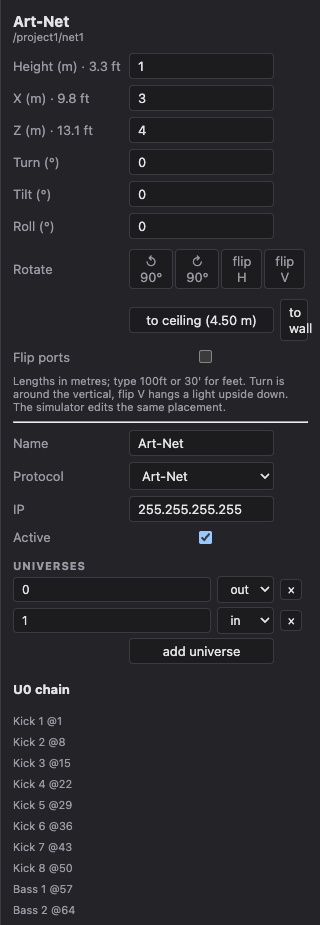

Then press **repatch** in the header: it numbers addresses along every chain from 1, so nothing overlaps.

A **DMX controller (faders in)** is a lighting desk or fader box. Set how many faders it has and cable its DMX out into an **in** universe on a node. Its faders then show up on the show tab's Inputs rail as `ch1`, `ch2`…, ready to pick a scene, force a drop or black out.

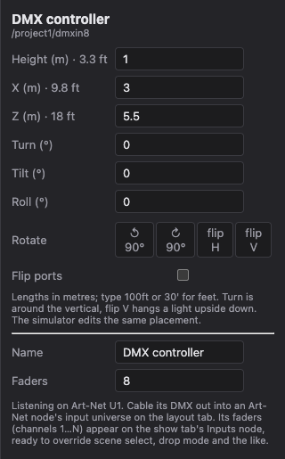

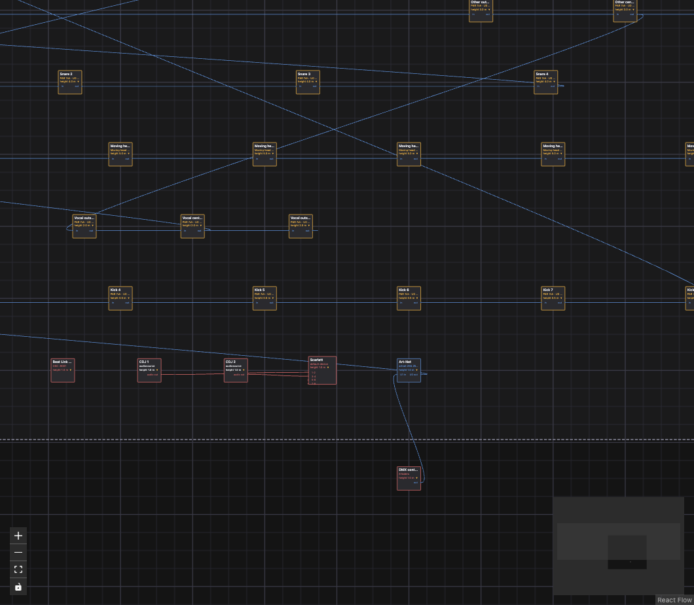

## Audio and software sources

- **Audio source** and **Audio input (interface)**: cable each source (a DJ mixer, player, mic or laptop) into a channel on an audio interface such as a Focusrite. Each input becomes an audio signal on the show tab, for a Level block.
- **Beat Link Trigger (OSC)**: Pioneer deck state (playing, on air, beat, BPM, song) over OSC. List your cue songs in its panel and `song` becomes an index you can match.
- **AudioSlice (OSC)**: stem energy and hits (`kick/energy`, `snare/onset`, `beat/energy`…). **Push to AudioSlice** sets AudioSlice up to send them.
- **OSC out**: sends a value to another app, e.g. MadMapper. See [Recipes](recipes.md#dmx-faders-pick-a-section-and-turn-madmapper).

## Pixels: LED tubes and controllers

**LED tubes** (Pixels tab) places a set of tubes as one node. Each tube has a name, LED count, length, pixel protocol (SK9822, APA102, WS2812, WS2811) and a shape.

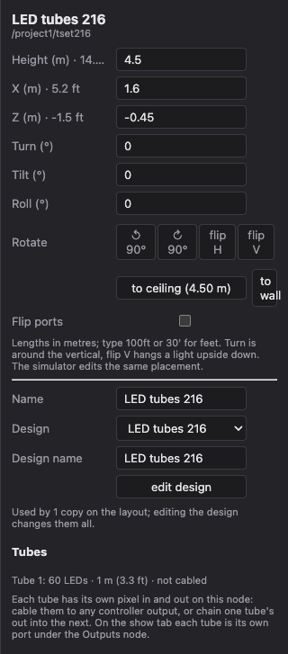

**edit design** opens the 3D designer: double-click a tube to bend it, drag the yellow points, or pick a prebuilt **tree**, **burst** or **fan** and press **make shape**. A design is a template: every copy on the layout follows it, and saved designs appear under Saved tube designs in the palette.

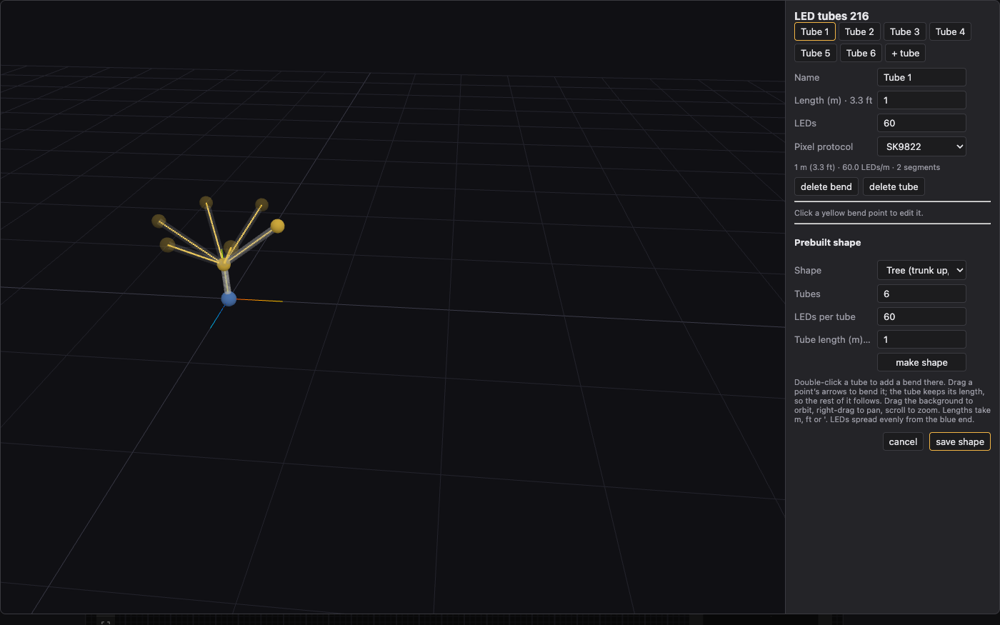

A **Pixel controller (Art-Net)** is the board that drives them: IP, protocol, outputs, LEDs per output, LEDs per universe and start universe. Cable a board output into a tube's pixel in, then chain tube out → next tube in. The panel shows which universes each output uses and which tubes sit on it, and warns when an output is over its LED count.

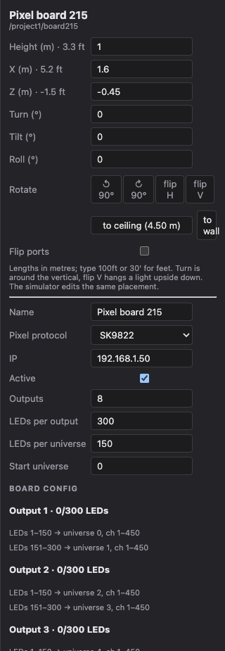

## The Rig panel

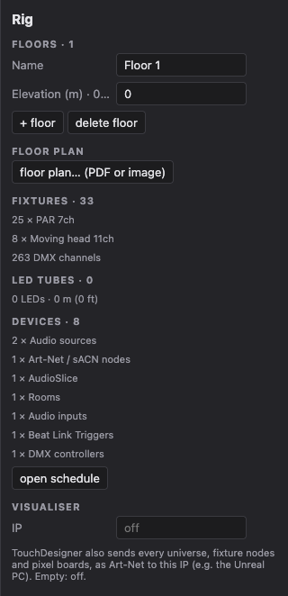

Counts per fixture type, total DMX channels, LEDs and tube length, and devices by kind. **open schedule** jumps to the patch sheet. The **Visualiser** IP is covered in [Outputs](outputs.md#visualiser-ip).
