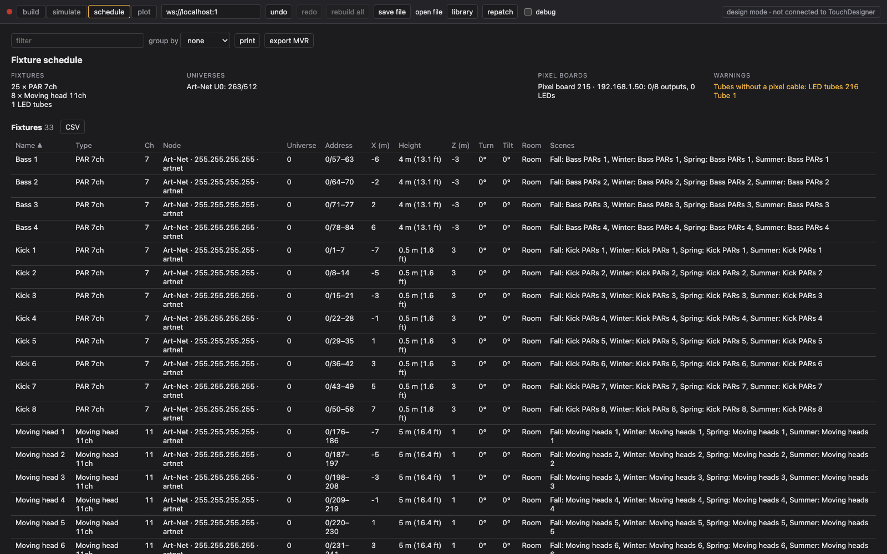
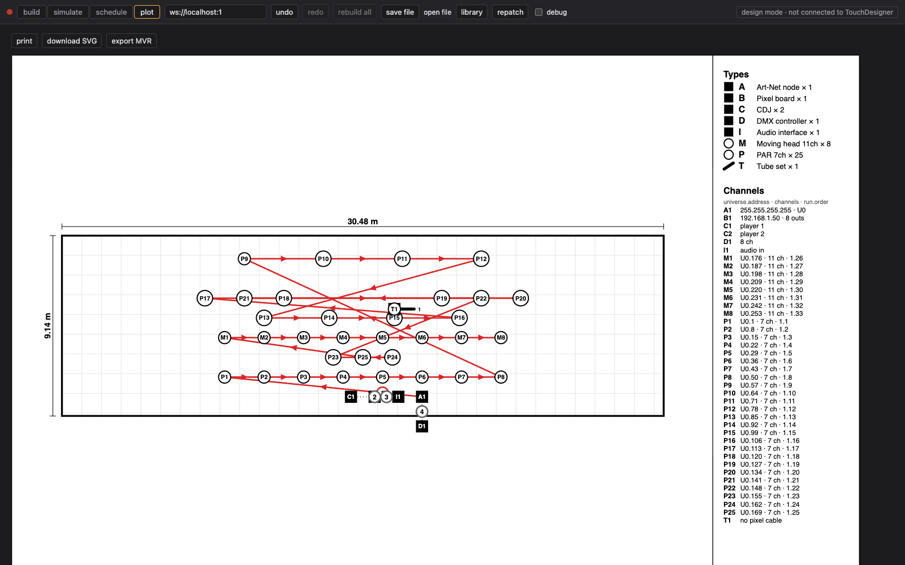
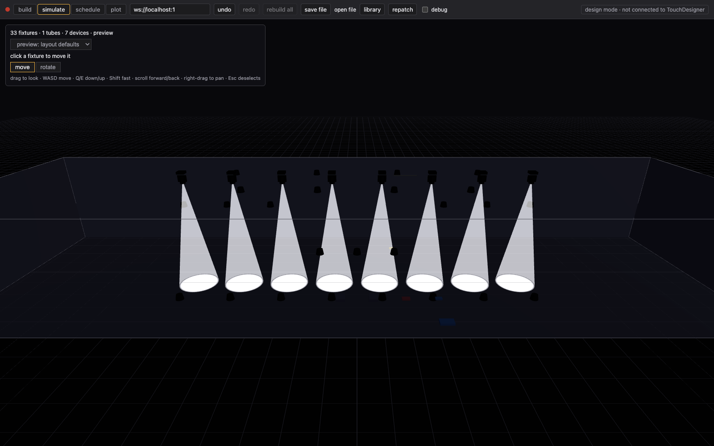

# Outputs

Paperwork for the crew and a rig file for previsualisation, all from the layout.

## Schedule

The **schedule** page is the patch sheet.

- **Summary**: fixtures per type, every universe with its used channels (`Art-Net U0: 263/512`), pixel boards, and warnings: overlapping addresses, fixtures past channel 512, a universe sent by two devices, pixel outputs over their LED count, unpatched fixtures or tubes.
- **Fixtures**: one row per fixture with type, channels, node, universe, address range, position, height, turn, tilt, room and the scenes driving it.
- **LED tubes**: one row per tube with board, output, LED range and universes.

Click a header to sort, type in **filter** to narrow, **group by** universe, type or floor, and click a row to jump to the fixture on the layout. **CSV** downloads a table as shown; **print** prints a light landscape sheet or saves a PDF.

## Plot

The **plot** page is a printable lighting plot for riggers, one per floor.

- Circles are fixtures, squares devices, thick lines LED tubes. A dashed outline is not patched.
- IDs like `P3` are the type letter and the order in the rig. The key on the right lists types and each ID's universe, address, channels and run (`1.13` is run 1, 13th on the cable).
- Red lines are the DMX runs with arrows along the chain; the floor plan, if any, is drawn underneath.
- Below the plan: a legend, warnings and one hand-off table per cable run and pixel run.

**print** or **download SVG** to hand it out.

## MVR export to Unreal

**export MVR** on the plot or schedule page downloads `lsgleam-show.mvr`: every fixture with its type, mode, position, aim and DMX address, plus rooms, LED tubes and floor plans as 3D meshes. Re-exporting updates the same fixtures. The [README](../README.md#unreal-engine-preview-mvr) has the format details.

### Unreal Engine

In Unreal (5.x, Windows):

1. Edit → Plugins: enable DMX Engine, DMX Protocol and DMX Fixtures; restart.
2. Project Settings → Plugins → DMX → Communication Settings → Input Ports: add one with Protocol Art-Net, the network card's IP, Local Universe Start 1, Amount of Universes covering the highest universe + 1, Extern Universe Start 0 (Unreal universe 1 = Art-Net universe 0, matching the MVR). Make sure Receive DMX is on.
3. Drag `lsgleam-show.mvr` into the Content Browser. This makes a DMX Library (fixture types from the GDTFs, patch from the addresses). Drag the library into the level: a DMX MVR Scene Actor spawns a fixture Blueprint per fixture at its position, picked by matching attributes; change it per fixture type under "Fixture Type to Spawned Actor" if needed. Pan/tilt ranges of the stock moving head Blueprint are set on the Blueprint, so check them against the profile (e.g. 540° / 270°).
4. Rooms, tubes and floor plans are not imported by a plain MVR import (Unreal needs Datasmith for MVR geometry). Rename the `.mvr` to `.zip`, unzip it and drag the `room-*.glb` / `plan-*.glb` / `tube-*.glb` files into the level at the origin.
5. Set the [visualiser IP](#visualiser-ip) to the Unreal PC's IP.
6. For beams: Exponential Height Fog with Volumetric Fog on, Lumen for global illumination (Project Settings → Rendering), or the Path Tracer viewport mode for stills; keep the room meshes so beams have something to land on.

## Visualiser IP

Layout tab → Rig → **Visualiser IP**. TouchDesigner then also sends every universe, from the DMX nodes and the pixel boards, as Art-Net to that IP (the Unreal PC, or any visualiser). Empty turns it off. Two nodes sending the same universe number collide on the visualiser.

## Simulator

The **simulate** page is a 3D view of the layout. Without TouchDesigner, **preview: layout defaults** lights every fixture from its own values, or **preview: Fall** (any scene) shows what that scene sends. With several floors, **cut above** hides the floors on top. With TD connected, **live from TouchDesigner** reads the real DMX, so a wrong address shows up here first.

Drag to look, WASD to move, Q/E down and up, scroll forward and back. Click a fixture to move or rotate it; it moves on the layout too.
