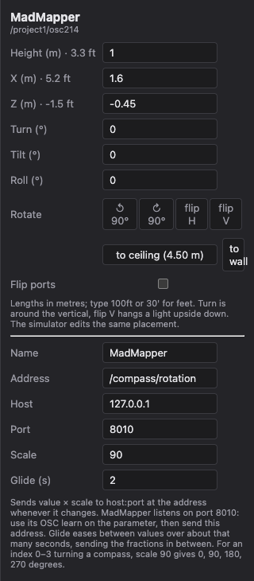
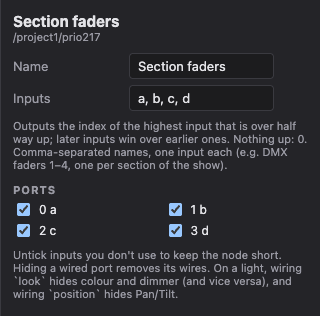
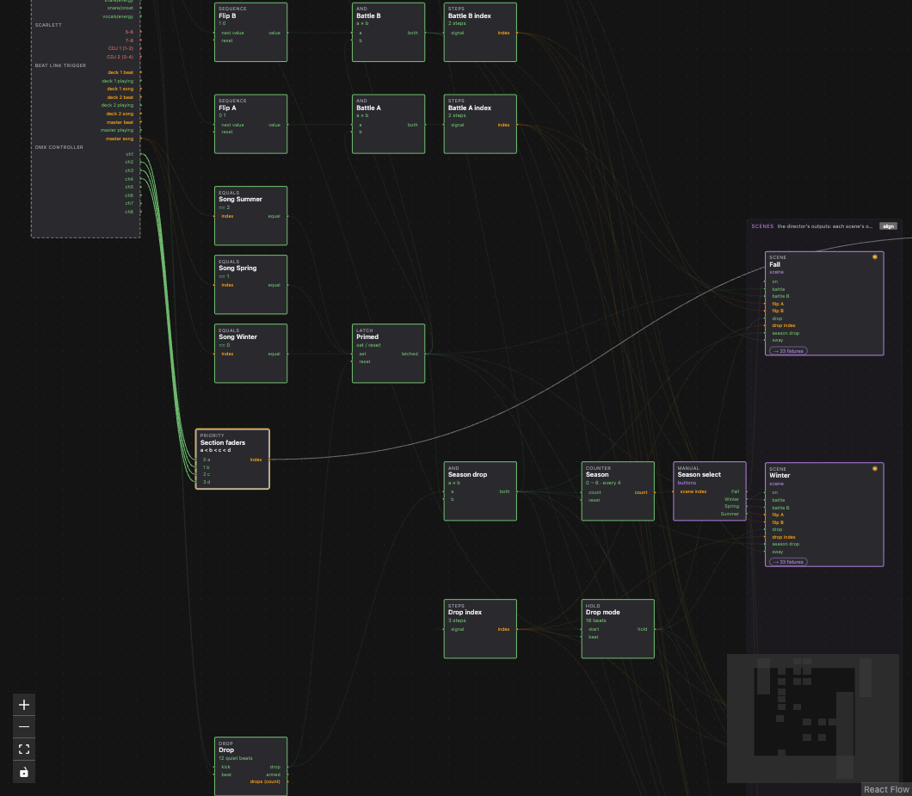
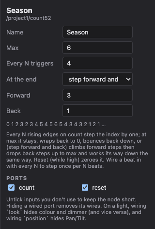
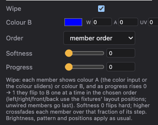

# Recipes

Worked examples. Each assumes the hardware is already on the [layout](layout.md).

## DMX faders pick a section and turn MadMapper

Four faders on a desk choose one of four sections of the show (in the example show, the four seasons). The highest fader that's up wins, the lights follow, and a MadMapper parameter (say a compass) turns 90° per section.

1. **Layout**: add a **DMX controller**, set Faders to 4 or more, and cable its DMX out into an **in** universe on your Art-Net node.
2. **Layout**: add an **OSC out** and name it (e.g. MadMapper). Set:
   - Address: what MadMapper should listen to, e.g. `/compass/rotation`. In MadMapper, use OSC learn on the parameter.
   - Host: the MadMapper machine's IP (`127.0.0.1` if it's the same computer). Port: 8010.
   - Scale: 90, so sections 0–3 send 0, 90, 180, 270.
   - Glide: 2 s, so the compass eases round instead of jumping.

   

3. **Show tab**: add **Priority** (Logic). Name its four inputs after your sections (they default to `a, b, c, d`). Wire faders `ch1`–`ch4` from the Inputs rail into them.

   

4. Wire Priority's `index` into **Scene select**'s `index` (scene 0 is the first scene, so keep the sections in that order), and into the OSC out port on the Outputs rail.

Push fader 3: the index is 2, the third section fades in, and MadMapper glides to 180. With faders 1 and 3 both up, 3 wins. With nothing up the index is 0.

## Step forward and back every bar

A Counter that moves once every 4 beats, three steps forward and one back: 0 1 2 3 2 3 4 5 4 5 6, then back down the same way.

1. **Show tab**: add **Counter** (Logic). Wire a beat pulse into `count`, e.g. AudioSlice `beat/energy` from the Inputs rail.
2. Set **Every N triggers** to 4 (one step per bar), **Max** to 6, **At the end** to *step forward and back*, **Forward** 3 and **Back** 1. The panel spells out the sequence.
3. Wire its index where you need it: Scene select's `index`, or into a scene's Index input and on to a Colours or Looks block.
4. Optional: wire a Drop's `drop` into `reset` to start over at every drop.

The other end modes: *stay at max* (0 1 2 3 3 3), *wrap to 0* (0 1 2 3 0 1) and *bounce back* (0 1 2 3 2 1 0 1).

## Battle turnover as a colour wipe

When team B takes the battle, the room wipes from team A's colour to team B's, left to right.

1. **Show tab**: open the battle scene and add a **Signal** input named `battle B`. On the show tab, wire whatever means "B is winning" into that port: a DMX fader, or an Equals on BLT's `song`.
2. **In the scene**: add a **group out** for your PARs (say 8 members) and patch the members to the fixtures (patch matrix, **Fill in order**).
3. In the group's panel set its colour sliders to team A's colour, tick **Wipe**, pick **Colour B**, set **Order** to *left → right* and **Softness** to about 0.3.
4. Add a **Fade** (Time): rise 4 s, fall 4 s. Wire `battle B` → Fade → the group's `progress`.

As `battle B` goes to 1 the Fade ramps progress 0 → 1 over 4 s and the fixtures flip to colour B one at a time, ordered by where they hang on the layout. When it drops back, the wipe runs back. Wire a colour into `color` / `color B` instead of the sliders to drive the team colours from a Colours block.

## A scene per song

1. In the **Beat Link Trigger** panel, list the cue songs. `song` becomes the index of the playing track in that list.
2. **Show tab**: one **Equals** per song (value 0, 1, 2…), each fed from the deck's `song`.
3. Wire each Equals into its scene's `on`, and leave a fallback scene's `on` unwired: it takes whatever weight is left.

## Hold a drop for 16 beats

1. **Drop** (Time): wire kick energy into `kick` and a beat pulse into `beat`. It fires `drop` when the kick comes back after a quiet stretch.
2. **Hold** (Time): `drop` into `start`, the beat into `beat`, Beats 16.
3. **Fade**: rise 0, fall 4. Hold → Fade → the drop scene's `on`. The drop snaps in, stays 16 beats and fades back out over 4 s.
