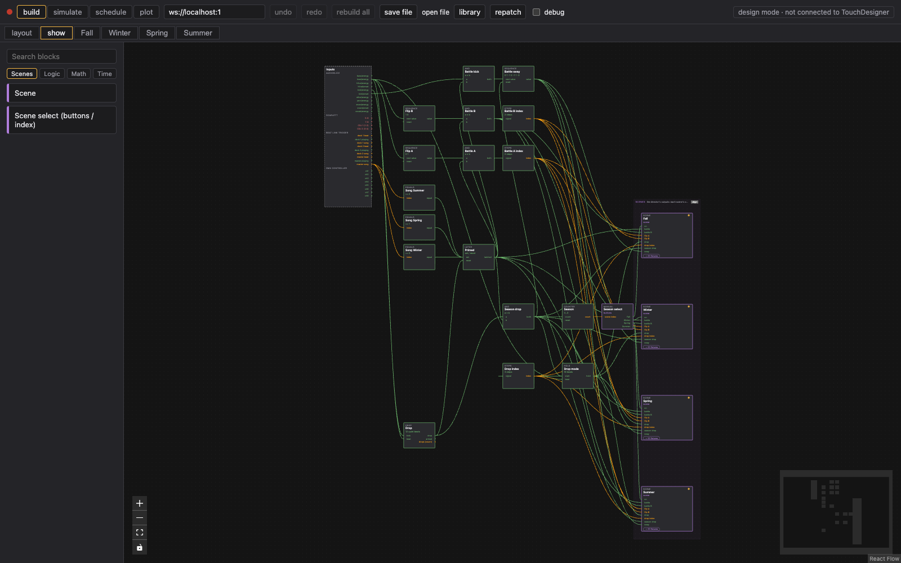
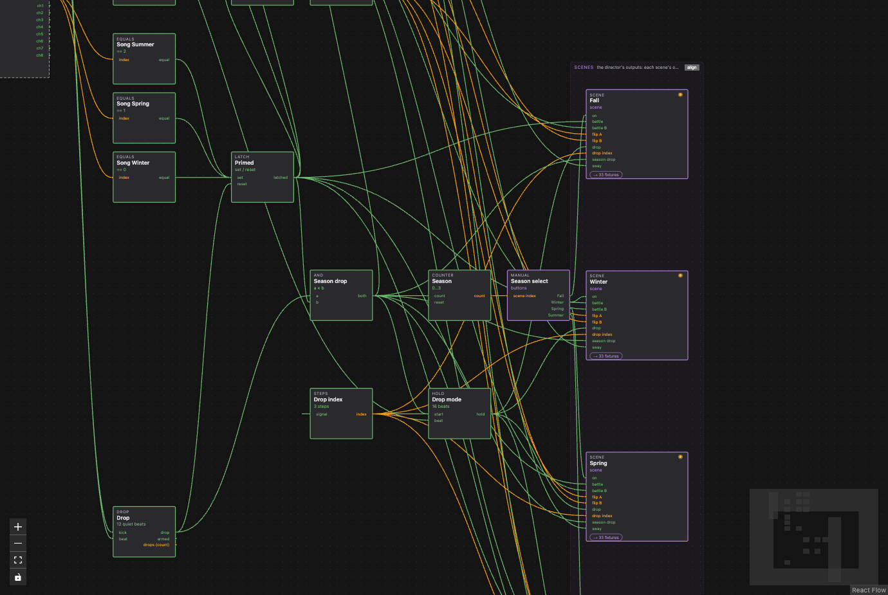
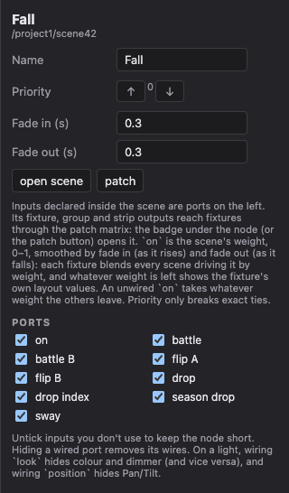
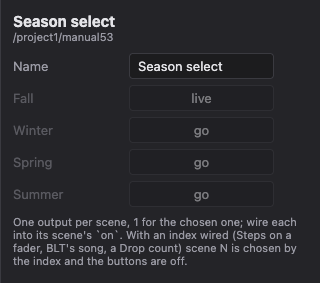
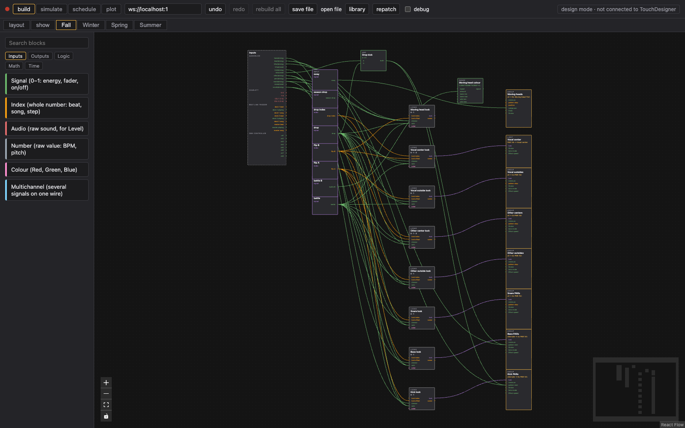
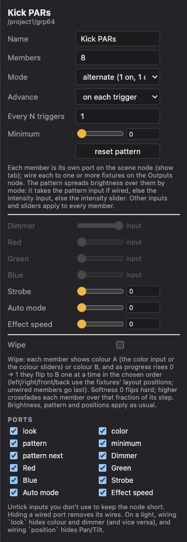
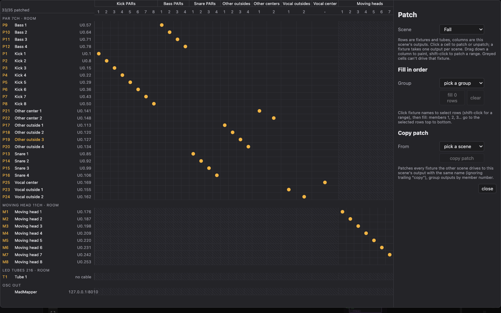

# Show and scenes

A **scene** is one way of lighting the room: a season, a drop, a battle. The **show** tab decides how much of each scene is on at any moment.

## The show tab

- **Inputs** (left rail): every signal from the layout, grouped by device: AudioSlice stems, audio inputs, Beat Link Trigger decks, DMX controller faders.
- **Logic** in the middle: blocks from the Scenes, Logic, Math and Time palette tabs that turn those signals into decisions (a song cue, a drop, a fader).
- **Scenes** (the zone on the right): one node per scene. **align** stacks them in priority order next to the logic that drives them.
- **Outputs** (right rail): appears once there's an OSC out on the layout or a fixture wired directly from the show tab.

## Scenes are weights

Each scene node has an `on` input, 0–1. That's its weight: each fixture blends every scene driving it by weight, and any weight left over shows the fixture's own layout values. So:

- one scene at 1 is that scene;
- two scenes at 0.5 each are a crossfade (moving heads sweep between their positions);
- a scene with `on` unwired takes whatever weight the others leave, so it's the fallback.

The scene panel sets **Fade in** and **Fade out** in seconds: how long `on` takes to ramp up and down. 0 is a hard cut. The **Priority** arrows only break exact ties.

## Choosing a scene

**Scene select (buttons / index)** has one output per scene, 1 for the chosen one. Wire each output into its scene's `on`.

- Press **go** in its panel to switch by hand.
- Or wire an index into it: Steps on a DMX fader, Beat Link Trigger's `song`, a Counter or a Priority. Scene N follows the index and the buttons turn off.

For layered rules (battle beats drop beats season), use Not and And: battle `on` = battle; drop `on` = drop × Not(battle); season = Not(battle) × Not(drop).

## Inside a scene

Double-click a scene node, or click its tab, to open it.

- **Inputs** palette tab: an Input block (signal, index, audio, number, colour or multichannel) adds an input port to the scene node. Wire the show-tab logic into that port and it comes out here. The scene also has the Inputs rail on its left, for sources you want straight from the layout.
- **Outputs** palette tab: what the scene sends.
  - **Fixture out**: one virtual fixture. Everything patched to it gets the same values. Unwired channels send its sliders.
  - **Fixture group out**: N members of one fixture type with a built-in pattern, stored positions and a colour wipe. Each member is patched to its own fixtures.
  - **Pixel out (LED tubes)**: an effect for LED tubes (solid, band, fill, chase, ramp).
  - **Signal / Index / Number out**: a value for an OSC out.
- **Logic, Math, Time**: the same blocks as the show tab, to shape the inputs into looks.

A wired input greys out its field in the panel and reads "input".

## Patching a scene to fixtures

The badge under a scene node (**→ 33 fixtures**) or **patch** in its panel opens the patch matrix. Rows are fixtures and tubes, columns are the scene's outputs (group members numbered).

- Click a cell to patch or unpatch. A fixture takes one output per scene.
- Drag down a column to paint; shift-click to patch a range.
- **Fill in order**: click fixture names to pick rows, choose a group, and members 1, 2, 3… go to those rows top to bottom.
- **Copy patch** from another scene: every fixture patched there goes to this scene's output with the same name, group members by number. Handy after copying a scene with ⌘C / ⌘V.

Greyed cells can't drive that fixture (wrong fixture type, or outside the scene's rooms).

## Rooms

With two or more rooms (Box blocks) on the layout, the scene panel lists them. Tick rooms to keep a scene to them: it can only patch fixtures inside, and ticking unpatches fixtures outside (undo brings them back). Nothing ticked means every room.
